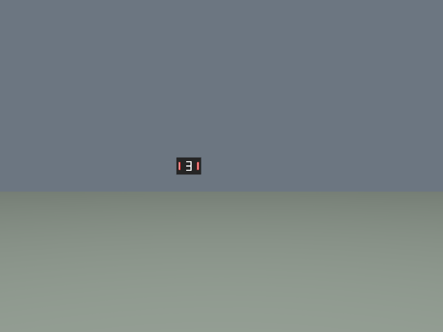
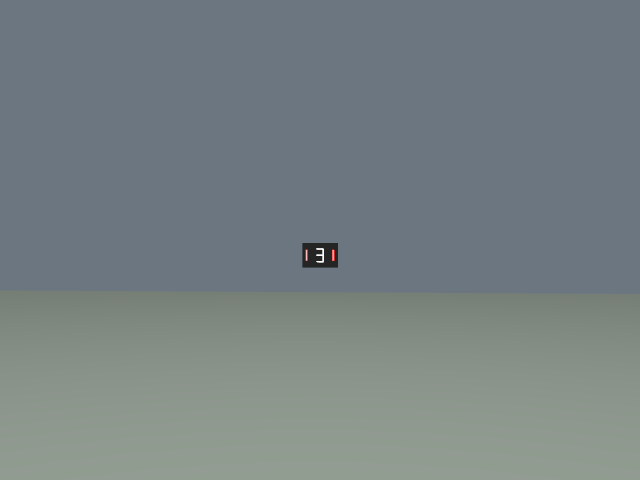
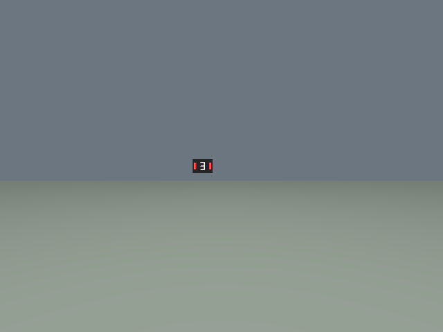
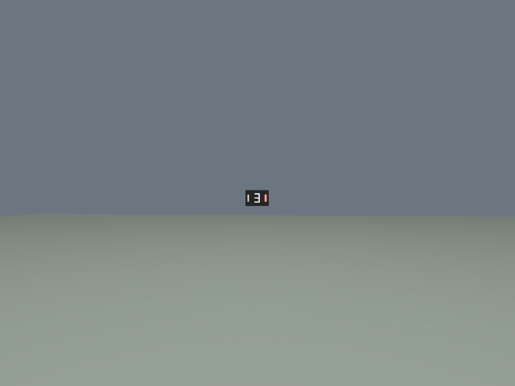
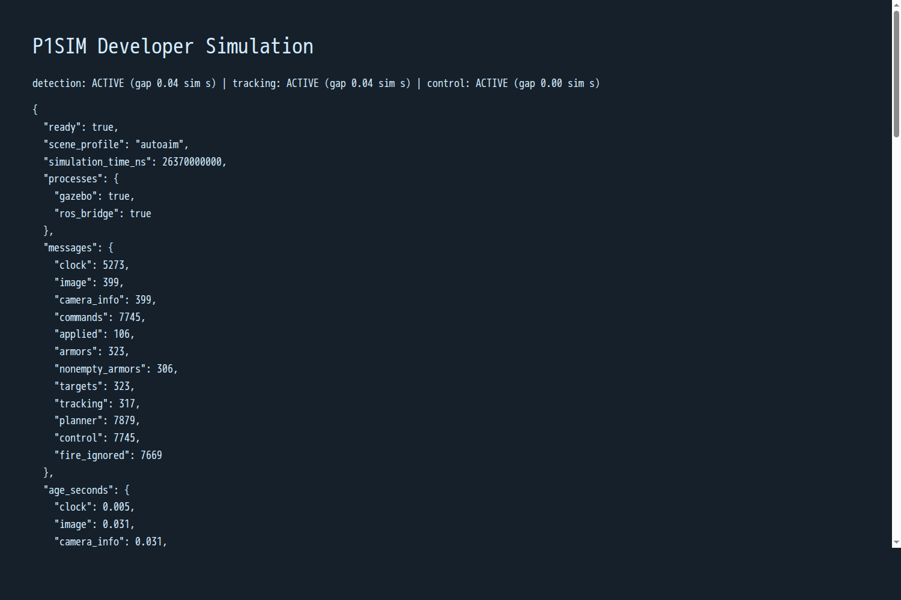

# Sustained AutoAim developer scene

Use `P1SIM_SCENE=autoaim` before `dev up` with the workspace and CPU launch
in [AUTOAIM.md](AUTOAIM.md). Rebuild your P1SIM dependency image from this
source revision before starting it. The ordinary `developer` scene remains
the generic quickstart default. Stop before changing profiles.

```bash
export P1SIM_SCENE=autoaim
./p1sim dev up
./p1sim dev run -- ros2 launch rm_vision_bringup vision_bringup.launch.py camera:=external inference_device:=CPU
# In another terminal, using the same environment:
./p1sim dev record tuning-session
./p1sim dev status
```

The single static target is at Gazebo world `(2, 0.17, 1)` m. Its project-authored
black plate is 180 by 125 mm, light-bar centers are 135 mm apart, and red bars
are 18 by 55 mm with 4 mm pale cores. The seven-segment digit is project-authored
geometry. The camera uses a documented wide developer view: 90 degree horizontal
FOV, 640x480 RGB at 15 requested Hz, zero distortion. CameraInfo is computed
from the selected scene's actual FOV. Camera origin, TF convention, GimbalCmd
ABI and kinematic application semantics remain those of T229. This profile
is a useful presentation for this specific source/model pair, not a calibrated
competition camera or a detector robustness benchmark.

The live page shows current detection, tracking and control flags and their
positive-message gap ages in simulator seconds. Callback ages remain available
in wall seconds, so paused or disconnected sources cannot leave a stale ACTIVE
banner. `never` means no positive observation yet. A false current flag is shown
as WAIT / LOST even if a recent positive message exists. Armor IDs and Tracker
ID let a developer distinguish association changes from missing detections.

`/p1sim/visibility` is a recorded, read-only JSON diagnostic with image time,
last confirmed applied camera angles, projected target centers/corners and
FOV flags. It uses scene geometry and the ideal pinhole camera only. It never
publishes armors, targets, algorithm commands or parameters. Service completion
and rendering are asynchronous: one transition frame can differ from the
confirmed-pose projection. The bag checker independently checks actual red
target pixels in the image as well as the geometric diagnostic.

After recording and stopping the recorder, while the environment is still up:

```bash
./p1sim dev run -- python3 -m examples.autoaim_bag_check /data/bags/tuning-session --output /data/tuning-session.json
```

This observer audits the first Tracker acquisition and its following five
simulator seconds, including both trailing and leading gap edges. It checks
real positive armor/target/control messages, exact receipt identities including
multiplicity and contiguous consumed-command sequences, applied-pose JointState/TF witnesses, target visibility and camera
image changes near applications. No algorithm input is synthesized. The command
expects the default current AutoAim topics. A nonzero exit preserves negative
evidence rather than picking a later convenient window. Use the live
`examples/autoaim_check.py` as well for source-image-time TF and node-boundary
checks. `python3 tests/sustained_acceptance.py` drives two clean starts, records
both, invokes both observers and checks consumer/container/network cleanup;
set the ordinary P1SIM environment variables and a fresh state directory first.

## Root-cause evidence

T229's retained bag has nonempty Detector output through 6.470 s, its first
camera application at 6.510 s, empty Detector output at 6.535 s and Tracker
loss at 6.735 s. All four targets remain inside the changed image. Thus Tracker
loss followed missing Detector input; camera FOV exit does not explain it.
The selected target's presentation becomes marginal at the new raster position.

Read-only CPU inference on those real images, using the unchanged model and
matching native preprocessing, showed the winning pre-motion candidate as red
with confidence 0.900; after motion the highest candidate was extinguished
(class 2) at 0.953. Other candidates existed, so this alone is not a complete
explanation of every internal Detector rejection. No algorithm was modified.

Bounded scene probes retained the same consumer and production settings:

| Presentation | Observed result |
|---|---|
| Original recognized target isolated, 2 m / 60 degrees | Acquired, then lost after camera application |
| Same target at 1.2 m | No positive Detector output |
| Original target at 2.8 m | Acquired, then lost after camera application |
| Narrower, redder core at 2.8 m | Acquired, then lost; actual before/after peak confidence 0.835 / 0.775 |
| Shorter black panel at 2 m | No positive Detector output |
| Wider red bars, 2 m / 60 degrees | About three seconds of tracking, then lost while still visible |
| Wider bars with 1280x960 / 60 degrees | Acquired, then lost; resolution alone insufficient |
| Wider bars, 640x480 / 90 degrees | Sustained real closed loop; see observed evidence below |

Additional read-only distance probes rendered actual Gazebo frames, including
initial and approximate aimed views. Their confidence/color outputs are
presentation diagnostics, not scientific scores or acceptance substitutes.
The final result uses real unchanged ROS Detector/Tracker/Planner output.

Root-cause class: simulator-owned target presentation / raster scale and
viewpoint sensitivity. Multiple targets and FOV exit were excluded as necessary
causes by the isolated-target run and the image/geometry witnesses. Rare TF
extrapolation warnings also occurred in a failed probe; they do not account
for the persistent empty detections on an otherwise static, visible image.
The selected profile changes presentation; it makes no claim to repair the
Detector's behavior on arbitrary imagery.

## Observed sustained use

The final runtime source passed two clean starts on 2026-11-12. Detector,
Tracker, Planner, production YAML and owner-installed 0526 weights were frozen;
only the ordinary CPU execution device override was used.

| Run | Window, simulator seconds | Max detection gap | Max tracking gap | Exact receipts |
|---|---|---|---|---|
| Clean start 1 | 5.285–10.285 | 0.265 s | 0.130 s | 2236/2236 |
| Clean start 2 | 5.350–10.350 | 0.265 s | 0.135 s | 2294/2294 |
| Longer observation | 5.215–35.215 | 0.330 s | 0.135 s | 11410/11410 |

Every recorded consumed-command sequence was contiguous from 1 through the
last receipt, extending beyond the audited window. The first two windows each
contained 24 command-induced camera image changes; the 30-second observation
contained 151. All applied poses had matching subsequent JointState and TF.
Fire requests remained ignored. The unchanged loop observer also passed
image-source-time TF and absent-hardware checks on all three runs. Consumer
Ctrl-C and `down` left no task container or network. The generic quickstart's
record/reset/down/second-up regression passed on the final runtime as well.

The two required bags remain directly readable at the exact local pointers in
the evidence manifest. The supplementary 30-second and generic bags are archived
as DB3 gzip files with metadata retained: run `gzip -dk <file.db3.gz>` before
reading with ros2 bag. Original and archive hashes are recorded; compression was
verified by re-reading the exact original bytes. Failed/redundant task-private
bags are `HISTORICAL_SUMMARY_ONLY`, with negative summaries and visual evidence
preserved. No earlier task's data or owner workspace was deleted.

See [sustained observed evidence](sustained-observed.json) for source identity,
two start windows, exact gaps, receipts, feedback, artifact checksums and limits.
Private model XML/BIN and installed consumer binaries are owner-supplied,
read-only runtime dependencies and are never included in this repository.

Actual rendered frames, without annotation or synthetic algorithm input:

| Marginal 60 degree target, before | Same target after camera motion |
|---|---|
|  |  |

| Sustained 90 degree profile, before | Same profile after real Planner commands |
|---|---|
|  |  |


